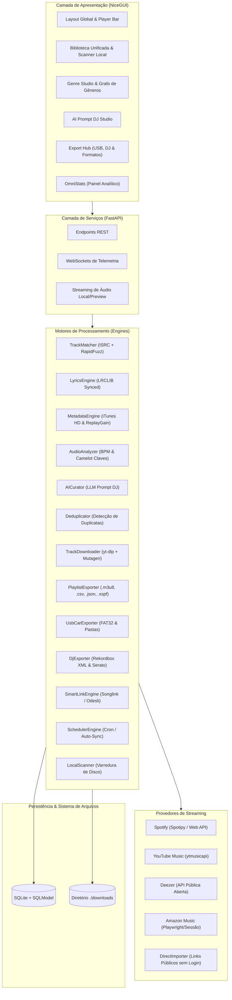
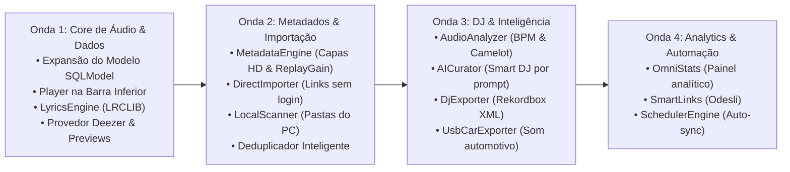

# 📑 OmniPlaylist - Blueprint Arquitetural & Especificação das 18 Funcionalidades

Este documento consolida a arquitetura completa, a especificação técnica detalhada e o roteiro de execução para todas as novas funcionalidades que transformarão o **OmniPlaylist** em uma central unificada de áudio, metadados, streaming e curadoria.

---

## 🏛️ 1. Visão Geral da Arquitetura Expandida

---

## 🧩 2. Especificação Técnica Detalhada das 18 Funcionalidades

### Bloco A: Inteligência, Curadoria & Áudio (AI & Analytics)

#### 1. Smart DJ por Prompt com IA (`app/engines/ai_curator.py`)
- **Objetivo**: Permitir criar playlists a partir de pedidos em linguagem natural (*ex: "músicas animadas para treino com BPM acima de 125"* ou *"indie melancólico dos anos 2000"*).
- **Mecanismo**: Interpretador de prompts baseado em LLM (Gemini API ou regras heurísticas locais offline) que converte a intenção em filtros de banco de dados (BPM, chave, intervalo de anos, gêneros da taxonomia e energia).

#### 2. Extração de BPM e Clave Musical / Roda de Camelot (`app/engines/audio_analyzer.py`)
- **Objetivo**: Extrair Batimentos Por Minuto (BPM) e clave tonal (ex: `8A / Am`, `11B / A`) para ordenação de mixagem harmônica contínua sem choques de tom.
- **Mecanismo**: Leitura de metadados das APIs (Spotify/Deezer) com fallback via análise de espectro em sinal de áudio local.

#### 3. Deduplicador Inteligente de Biblioteca (`app/engines/deduplicator.py`)
- **Objetivo**: Identificar e fundir versões duplicadas da mesma faixa (remasters, edições de rádio, faixas ao vivo e compilações).
- **Mecanismo**: Algoritmo de score ponderado (ISRC idêntico = 100%, título normalizado com RapidFuzz > 88% + mesma duração +- 4s = duplicata provável).

---

### Bloco B: Metadados, Capas e Letras Sincronizadas

#### 4. Sincronizador de Letras Sincronizadas (`app/engines/lyrics_engine.py`)
- **Objetivo**: Baixar letras linha a linha sincronizadas no padrão karaokê (.LRC).
- **Mecanismo**: Integração direta com a API pública do **LRCLIB** (sem chave de acesso); gravação do arquivo `.lrc` e incorporação nas tags ID3 (`USLT` e `SYLT`).

#### 5. Downloader de Capas em Alta Resolução (`app/engines/metadata_engine.py`)
- **Objetivo**: Substituir miniaturas borradas por artes oficiais em alta resolução (1400x1400 até 3000x3000).
- **Mecanismo**: Consulta automática ao catálogo público do iTunes Search API e Cover Art Archive do MusicBrainz.

#### 6. Normalizador de Volume ReplayGain / EBU R128 (`app/engines/metadata_engine.py`)
- **Objetivo**: Evitar variações extremas de volume entre faixas de diferentes fontes.
- **Mecanismo**: Análise do filtro `ebur128` do FFmpeg para computar o volume integrado (LUFS) e gravar as tags ID3 `REPLAYGAIN_TRACK_GAIN` sem distorção destrutiva no áudio original.

---

### Bloco C: Provedores & Importação Descomplicada

#### 7. Importação por Link Público sem Login (`app/engines/direct_importer.py`)
- **Objetivo**: Permitir que o usuário cole URLs públicas de playlists do Spotify, YouTube ou Deezer e o sistema extraia todas as faixas sem exigir login nem criação de apps de desenvolvedor.
- **Mecanismo**: Scrapers de metadados oEmbed e parsing de schemas JSON-LD públicos.

#### 8. Provedor Aberto Deezer (`app/providers/deezer.py`)
- **Objetivo**: Obter ISRC confiável, gêneros detalhados, dados de lançamentos e prévias de áudio de 30 segundos em alta fidelidade.
- **Mecanismo**: Implementação do `BaseMusicProvider` consumindo a API REST aberta do Deezer (`https://api.deezer.com/`).

#### 9. Scanner de Arquivos Locais (`app/engines/local_scanner.py`)
- **Objetivo**: Indexar coleções já salvas no computador (`.mp3`, `.flac`, `.wav`, `.m4a`, `.ogg`).
- **Mecanismo**: Varredura recursiva de diretórios com Mutagen para extrair metadados, capas embutidas e calcular hashes para indexação no SQLite.

#### 10. Exportador para Softwares de DJ (`app/engines/dj_exporter.py`)
- **Objetivo**: Exportar playlists para softwares profissionais de discotecagem.
- **Mecanismo**: Geração de esquemas XML estruturados no formato oficial do **Pioneer Rekordbox** (`<DJ_PLAYLISTS>`), **Serato** e **Traktor**.

---

### Bloco D: Interface Interativa, Player & Visualizadores

#### 11. Reprodutor de Áudio Funcional na Barra Inferior (`app/ui/layout.py`)
- **Objetivo**: Tornar a barra inferior um reprodutor de mídia HTML5 completo.
- **Mecanismo**: Componente reativo NiceGUI com barra de progresso (scrubber), controle de volume, atalhos de teclado e capacidade de reproduzir prévias de 30s ou arquivos MP3 locais já baixados.

#### 12. Visualizador de Forma de Onda / Waveform (`app/ui/components/waveform.py`)
- **Objetivo**: Exibir graficamente a dinâmica da música (picos de energia e transições).
- **Mecanismo**: Renderização de waveform dinâmica via WaveSurfer.js embutido.

#### 13. Grafo Interativo de Afinidade e Gêneros (`app/ui/pages/genre_graph.py`)
- **Objetivo**: Visualizar a biblioteca como uma rede/constelação interativa de nós onde artistas, músicas e subgêneros se conectam.
- **Mecanismo**: Visualização em teia via biblioteca de grafos interativos (Vis.js / Cytoscape).

---

### Bloco E: Automações, Hardware & Compartilhamento

#### 14. Agendador Periódico de Sincronização (`app/engines/scheduler_engine.py`)
- **Objetivo**: Executar rotinas automáticas recorrentes (ex: atualizar toda segunda-feira uma playlist espelhada ou baixar novos favoritos).
- **Mecanismo**: Fila de agendamento assíncrona em segundo plano no ciclo de vida da aplicação.

#### 15. Exportador para Som Automotivo / Pen Drive (`app/engines/usb_exporter.py`)
- **Objetivo**: Exportação inteligente para pen drives com estruturação amigável para centrais multimídia automotivas.
- **Mecanismo**: Criação de hierarquia `[Artista]/[Ano - Álbum]/[Número] - [Título].mp3`, renomeando caracteres ilegais para padrão FAT32/exFAT.

#### 16. Módulo de Backup & Sincronização em Nuvem (`app/engines/backup_engine.py`)
- **Objetivo**: Gerar snapshots da biblioteca e exportar para serviços em nuvem ou servidores WebDAV / Nextcloud.
- **Mecanismo**: Empacotamento de banco de dados e arquivos de playlist em pacotes compactados `.zip` com envio via WebDAV/HTTP.

#### 17. Painel OmniStats / Wrapped Pessoal Permanente (`app/ui/pages/stats_page.py`)
- **Objetivo**: Dashboard com estatísticas detalhadas de escuta e acervo.
- **Mecanismo**: Gráficos de distribuição de gêneros, décadas mais frequentes (anos 70, 80, 90, 2000, 2010, atuais), artistas mais presentes e métricas de cobertura de download.

#### 18. Gerador de Smart Links Universais (`app/engines/smart_links.py`)
- **Objetivo**: Gerar links universais (Odesli / Songwhip) para qualquer música da biblioteca, permitindo compartilhamento multiplataforma com um único link.

---

## 🗄️ 3. Expansão do Modelo de Dados (`UnifiedTrack`)

O modelo [`UnifiedTrack`](file:///C:/Users/Nicollas/.gemini/antigravity/scratch/omniplaylist/app/core/models.py#L23) receberá os seguintes novos campos:

| Campo | Tipo | Descrição |
| :--- | :--- | :--- |
| `bpm` | `Optional[float]` | Andamento musical detectado |
| `key` | `Optional[str]` | Clave harmônica / Camelot (ex: `8A`, `11B`) |
| `lyrics_synced` | `Optional[str]` | Conteúdo com timestamps no padrão `.lrc` |
| `lyrics_plain` | `Optional[str]` | Letra textual completa sem marcação |
| `preview_url` | `Optional[str]` | URL de amostra de áudio (30s) |
| `deezer_id` | `Optional[str]` | Identificador único no catálogo Deezer |
| `hd_cover_url` | `Optional[str]` | URL da arte em resolução ultra-alta |
| `release_year` | `Optional[int]` | Ano de lançamento oficial |
| `replay_gain` | `Optional[float]` | Ganho sugerido em dB para nivelamento EBU R128 |

---

## 📅 4. Cronograma de Execução em Ondas

