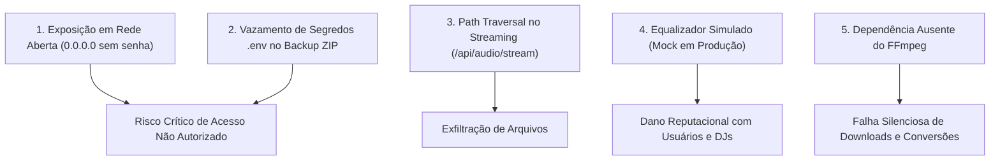

# Resumo Executivo de Auditoria — OmniPlaylist 2.0

**Para:** Liderança Técnica e Gestão de Produto  
**De:** Antigravity (Auditoria Técnica Independente)  
**Data:** 05/11/2026  
**Classificação:** Relatório Executivo Conclusivo  
**Documento Técnico de Referência:** [`docs/auditoria/relatorio_tecnico_consolidado.md`](file:///C:/Users/Nicollas/Desktop/omniplaylist/docs/auditoria/relatorio_tecnico_consolidado.md)

---

## 1. Veredito Executivo

> [!CAUTION]
> ### PARECER FINAL: NÃO APROVADO PARA PRODUÇÃO / DISTRIBUIÇÃO
> O **OmniPlaylist 2.0** apresenta uma base visual rica e conceitos inovadores de curadoria harmônica e sincronização inteligente. No entanto, **o software encontra-se em estágio de protótipo técnico**, com **funcionalidades centrais simuladas (Mocks)**, **vulnerabilidades críticas de segurança da informação** e **quebras operacionais graves decorrentes de dependências de sistema ausentes**.

---

## 2. Quadro Resumo de Maturidade (Scorecard)

```
[==================== 45% ====================]
STATUS GERAL: PROTÓTIPO AVANÇADO COM MOCKS E RISCOS DE SEGURANÇA
```

| Dimensão Técnica | Nota / Maturidade | Parecer Executivo |
| :--- | :---: | :--- |
| **Arquitetura & Código** | **B+ (7.5/10)** | Código modular, tipado e bem organizado em Python 3.12 com SQLModel. |
| **Funcionalidades Centrais** | **C (5.0/10)** | Exportação, estatísticas e busca funcionam; equalizador e Amazon são simulados. |
| **Interface & Reprodução** | **C- (4.5/10)** | Visual moderno em NiceGUI; navegação interrompe a música; equalizador inoperante. |
| **Segurança & Privacidade** | **D (3.0/10)** | Sem autenticação; exposto em `0.0.0.0`; vazamento de segredos no backup; path traversal. |
| **Cobertura de Testes** | **D+ (3.5/10)** | 34/34 testes passam, mas são superficiais; 6 motores críticos possuem zero testes. |

---

## 3. O Que Realmente Funciona vs. O Que Não Funciona

### ✅ O Que Funciona Comprovadamente
1. **Integração Aberta com Deezer**: Busca no catálogo, obtenção de metadados confiáveis (ISRC, capa HD, preview de áudio).
2. **Motor de Letras (LRCLIB)**: Busca e download real de letras sincronizadas com tags de tempo em `.lrc`.
3. **OmniStats & Métricas**: Agregação analítica confiável do banco de dados (distribuição de gêneros, artistas e durações).
4. **Smart Sync & Modo DJ**: Criação de planos de cópia atômica com auditoria de espaço em disco e exportação estruturada para Rekordbox XML.
5. **Exportação Multi-formato**: Geração válida de playlists em M3U8, CSV, JSON e XSPF.
6. **Editor em Lote de Metadados**: Atualização em lote de campos no SQLite e tags ID3 físicas em arquivos MP3.

---

### ⚠️ O Que Está Parcialmente Quebrado ou Incompleto
1. **Player Contínuo**: A aplicação destrói a tag de áudio a cada clique no menu lateral, **cortando o som a cada troca de página**.
2. **Download Studio**: Baixa arquivos brutos do YouTube em formato WebM, mas **não converte para MP3 320k** porque o FFmpeg não está instalado no sistema.
3. **Audio Inspector**: Classifica erroneamente faixas baixadas do YouTube como **"Corrompidas"** porque o Mutagen falha em contêineres WebM.
4. **Smart DJ 2.0**: O algoritmo harmônico Camelot perde faixas em lote caso as instâncias não possuam chave primária persistida (`id=None`).
5. **Letras Visuais**: As letras são despejadas como bloco de texto estático com colchetes de tempo; não há rolagem dinâmica estilo karaokê.
6. **Botões Mortos na Biblioteca**: Os botões visíveis de *"Importar Spotify"* e *"Importar YT Music"* não possuem ação de clique programada.

---

### ❌ O Que É Puramente Simulado (Mocks)
1. **Equalizador DSP de 10 Bandas**: O painel gráfico com 10 sliders não possui Web Audio API nem filtros de áudio. Cada movimento de slider **apenas emite uma mensagem de `console.log` no console do navegador**, sem produzir nenhuma alteração acústica.
2. **Provedor Amazon Music**: Retorna faixas falsas codificadas de forma fixa (`"Sample Track for..."`). Não há conexão com a Amazon nem automação Playwright.
3. **Loudness Engine (Volume LUFS)**: Retorna sempre o valor fictício `-16.0 LUFS` rotulado como fallback devido à falta do binário FFmpeg no sistema operacional.

---

## 4. Os 5 Maiores Riscos de Negócio e Segurança



1. **Acesso Não Autorizado na Rede Local (Risco Crítico)**: Como o servidor roda em `0.0.0.0:8000` sem nenhuma autenticação ou senha, qualquer usuário ou dispositivo na mesma rede Wi-Fi/Ethernet pode acessar a interface, baixar arquivos, alterar metadados ou acionar a restauração, apagando o acervo do usuário.
2. **Exposição de Chaves Privadas**: O recurso de backup empacota o arquivo `.env` dentro do arquivo ZIP. Compartilhar ou subir esse arquivo em nuvens públicas vaza as chaves de API (`SPOTIFY_CLIENT_SECRET`).
3. **Leitura Arbitrária de Arquivos (Path Traversal)**: O endpoint `/api/audio/stream/{track_id}` não valida se o arquivo de áudio está restrito à pasta de downloads, permitindo que arquivos do sistema operacional sejam transmitidos pela rede.
4. **Dano Reputacional por Funcionalidades Fake**: Promover um equalizador gráfico DSP de 10 bandas para audiófilos e profissionais quando o recurso executa apenas `console.log` é um risco reputacional severo para o produto.
5. **Inconsistência de Dados e Quebra Operacional no Áudio**: A ausência do FFmpeg compromete 4 motores simultaneamente (conversor de qualidade, download studio, normalizador de volume e inspetor de corrupção).

---

## 5. Matriz de Decisão e Próximos Passos

### Decisão Recomendada: NÃO LANÇAR NESTE MOMENTO
Recomenda-se congelar lançamentos públicos até que as correções prioritárias do ciclo **P0** sejam finalizadas.

### Plano de Resgate Prioritário (3 Sprints):

| Sprint | Foco | Entregáveis Principais |
| :--- | :--- | :--- |
| **Sprint 1: Segurança & Hardening (P0)** | Blindagem e Estabilidade | • Fechar porta para `127.0.0.1` ou adicionar HTTP Basic Auth.<br>• Criar `.gitignore` para impedir vazamento de credenciais e `.db`.<br>• Remover `.env` do gerador de backup ZIP.<br>• Adicionar sanitização de caminhos (Path Traversal guard).<br>• Instalar FFmpeg portátil empacotado. |
| **Sprint 2: Correção de Motores & Mocks (P1)** | Integridade Funcional | • Substituir `console.log` do equalizador por Web Audio API real (`AudioContext` + `BiquadFilterNode`).<br>• Corrigir o bug de faixas perdidas no Smart DJ (`ai_curator.py`).<br>• Corrigir Mutagen para aceitar WebM sem acusar corrupção.<br>• Ativar `PRAGMA foreign_keys = ON;` e modo WAL no SQLite. |
| **Sprint 3: Experiência & Interface (P2)** | Refinamento do Produto | • Converter rotas do NiceGUI em SPA para reprodução contínua ininterrupta.<br>• Programar ações reais nos botões da Biblioteca.<br>• Implementar rolagem dinâmica estilo karaokê nas letras sincronizadas.<br>• Ajustar cores Tailwind para viabilizar temas claros. |

---

*Relatório consolidado e concluído em conformidade com as diretrizes da auditoria independente.*
